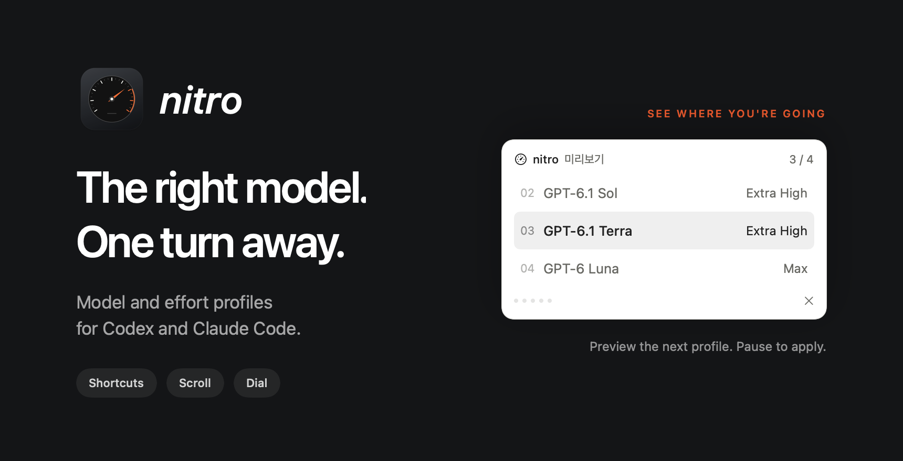
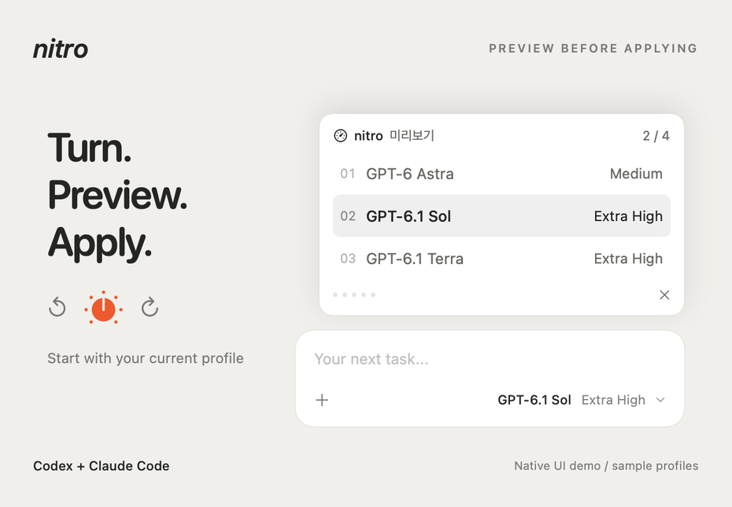

# Nitro

[English](README.md) / [한국어](README.ko.md) / [简体中文](README.zh-CN.md) / [日本語](README.ja.md) / [Español](README.es.md)

**Tu modelo y nivel de razonamiento, a un atajo de distancia.**

Nitro es una app nativa para la barra de menús de macOS.  
Cambia el modelo y el nivel de razonamiento en Codex y en la pestaña Code de Claude Desktop.  
Aplica un perfil con un atajo, recorre la lista o gira el dial de tu teclado.

[Descargar para Mac](https://github.com/jadhvank/nitro-releases/releases/latest) | [Novedades](https://github.com/jadhvank/nitro-releases/releases) | [Informar de un problema](https://github.com/jadhvank/nitro-releases/issues)

Requiere un Mac con chip de Apple y macOS 13 o posterior.

## Mira el siguiente perfil antes de cambiar

Gira el dial para recorrer los perfiles.  
Cuando veas el modelo y el nivel que quieres, detente.  
Nitro espera una breve pausa y aplica tu elección una sola vez.

La vista previa empieza en el perfil actual y se desliza hacia el siguiente.  
El destino queda en el centro, con los perfiles anterior y siguiente arriba y abajo.  
También puedes elegir un panel compacto o cambiar al instante, sin vista previa.

*Demo creada con la interfaz nativa de Nitro y perfiles de ejemplo.  
El cuadro de texto inferior es ilustrativo.  
Los modelos disponibles dependen de tu cuenta y de la versión del cliente.*

## Tres formas de cambiar

| Control | Función |
| --- | --- |
| Atajo de perfil | Aplica directamente un modelo y nivel guardados. Pulsa la combinación de teclas que quieras para asignarla. |
| Anterior y siguiente | Recorre tus perfiles o los ajustes Power de Codex. Elige entre vista previa y cambio inmediato. |
| Rueda del ratón o dial de volumen | Recorre la misma lista. El dial de volumen solo cambia modelos cuando una app compatible tiene el foco. |

Si usas ambos clientes, Nitro actúa sobre la app compatible que tenga el foco.  
Si solo usas uno, los atajos normales pueden traerlo al frente desde otra app.  
Los controles de volumen siempre conservan su función en las demás apps.

## Tu dial sigue controlando el volumen

Activa la opción de teclas de volumen en Nitro.  
Mantén las asignaciones de VIA como `KC_VOLD`, `KC_VOLU` y `KC_MUTE`.

- En Codex o en la pestaña Code de Claude, gira para cambiar de perfil.
- En otras apps, ajusta el volumen como siempre.
- Pulsa el dial para silenciar como siempre.

Esta opción también afecta a las teclas de volumen normales cuando una app compatible tiene el foco.  
El control con la rueda del ratón se configura por separado.

## Primeros pasos

1. Descarga `Nitro-<versión>.zip` desde la última versión.  
   Descomprímelo y mueve `Nitro.app` a Aplicaciones.
2. Abre Nitro y dale permiso en **Ajustes del Sistema → Privacidad y seguridad → Accesibilidad**.
3. Abre los ajustes desde el icono de Nitro en la barra de menús.  
   Elige Codex, Claude Code o ambos.
4. Abre un chat con el selector de modelos visible.  
   Comprueba la conexión y carga los modelos desde los ajustes del cliente correspondiente.
5. Configura tus perfiles y atajos.  
   Para recorrer los ajustes Power de Codex, carga primero la lista completa.

Por defecto, Nitro muestra los perfiles vecinos y aplica la elección tras una pausa de 1,2 segundos.  
Puedes cambiar el diseño, el tiempo de espera o activar el cambio inmediato.  
La demo de los ajustes permite probarlo sin modificar un chat real.

**La interfaz de la app está actualmente en coreano.** Estas traducciones del README no cambian el idioma de la app.  
Nitro admite Codex Desktop y la pestaña Code de Claude Desktop, no chats del navegador ni sesiones de terminal.

Abrir la descarga en macOS

La app está firmada con Developer ID. La versión actual no está notarizada por Apple, por lo que macOS puede pedir confirmación.

Después de intentar abrirla, si confías en la descarga, usa **Ajustes del Sistema → Privacidad y seguridad → Abrir igualmente** cuando aparezca.  
No hace falta desactivar Gatekeeper para todo el sistema.

## Actualizaciones y permisos

Busca actualizaciones desde la barra de menús de Nitro o desde sus ajustes. Sparkle se encarga de la descarga y el reinicio.

Los archivos de actualización y el feed están firmados.  
No necesitas una cuenta de GitHub para actualizar.

Nitro usa Accesibilidad de macOS para manejar los selectores de modelos de los clientes. No requiere claves de API ni un servidor local.

Los perfiles y registros de diagnóstico se guardan en tu Mac.  
Esos registros no incluyen conversaciones ni lo que escribes normalmente.  
Los cambios en la interfaz de los clientes pueden afectar a la compatibilidad.

## Sobre este repositorio

Este repositorio público contiene las descargas, la documentación y los informes de problemas de Nitro.  
El código de la app se mantiene en otro repositorio privado.  
Los archivos **Source code** ZIP y tarball que genera GitHub no son el instalador de la app.

Creado con SwiftUI y AppKit.  
Las actualizaciones usan [Sparkle](https://sparkle-project.org/); su licencia MIT se incluye en la app.  
Nitro es un proyecto independiente, sin afiliación con OpenAI ni Anthropic.

[Creado por jadhvank](https://github.com/jadhvank)
