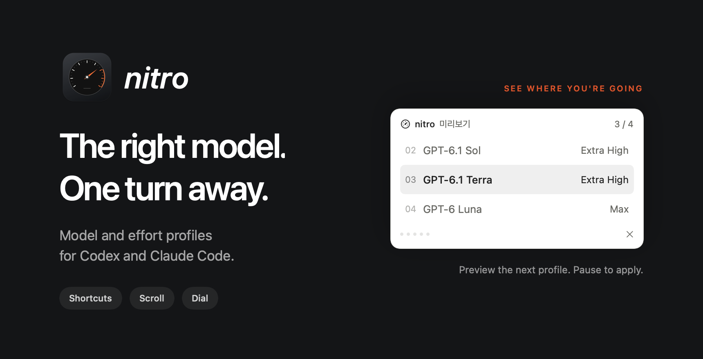
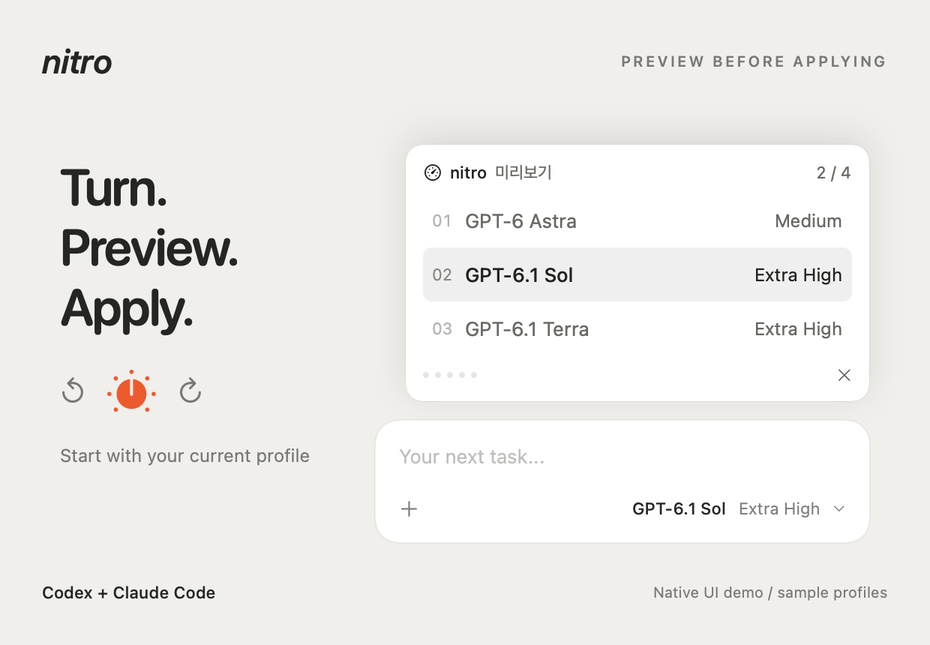

# Nitro

[English](README.md) / [한국어](README.ko.md) / [简体中文](README.zh-CN.md) / [日本語](README.ja.md) / [Español](README.es.md)

**モデルと推論の強度を、ショートカットひとつで。**

Nitro は、Codex と Claude デスクトップアプリの Code タブで、モデルと推論の強度を切り替える macOS メニューバーアプリです。ショートカットでプロファイルを直接適用したり、順番に切り替えたり、キーボードのダイヤルを回して選べます。

[Mac 版をダウンロード](https://github.com/jadhvank/nitro-releases/releases/latest) | [更新履歴](https://github.com/jadhvank/nitro-releases/releases) | [不具合を報告](https://github.com/jadhvank/nitro-releases/issues)

Apple シリコン搭載 Mac、macOS 13 以降に対応。

## 切り替える前に、次のモデルを確認

ダイヤルを回して候補を見て、使いたいモデルと推論の強度が見つかったら手を止める。少し待つと、最後に選んだプロファイルだけが適用されます。

プレビューは現在のプロファイルから始まり、次の候補へスライドします。適用する候補は常に中央、その前後は上下に表示されます。小さく表示したい場合はミニパネルに、待たずに切り替えたい場合は即時適用に変更できます。

*Nitro の実際のプレビュー UI とサンプルのプロファイルで作成したデモです。下の入力欄は説明用です。利用できるモデルはアカウントとクライアントのバージョンによって異なります。*

## 好きな操作で切り替える

| 操作 | 動作 |
| --- | --- |
| プロファイルのショートカット | 保存したモデルと推論の強度を直接適用。好きなキーの組み合わせを押して登録できます。 |
| 前へ、次へ | 自分のプロファイルや Codex 標準の Power プリセットを順番に移動。プレビュー後の適用と即時適用を選べます。 |
| マウスホイール、音量ダイヤル | 同じ一覧を前後に移動。音量ダイヤルは対応アプリにフォーカスがあるときだけモデルの切り替えに使われます。 |

両方のクライアントを使う場合、フォーカス中の対応アプリで動作します。ひとつだけ使う場合は、通常のショートカットで別のアプリから指定クライアントを前面に出せます。音量操作は、ほかのアプリでは常に元の動作を保ちます。

## 音量ダイヤルは、そのまま使える

Nitro の音量キー設定を有効にしてください。VIA の割り当ては `KC_VOLD`、`KC_VOLU`、`KC_MUTE` のままで使えます。

- Codex や Claude の Code タブでは、回してプロファイルを切り替え。
- ほかのアプリでは、いつもどおり音量を調整。
- 押すと、いつもどおりミュート。

対応アプリにフォーカスがある間は、通常の音量キーも同じ切り替え操作になります。マウスホイールは別の設定です。

## はじめに

1. 最新リリースから `Nitro-<バージョン>.zip` をダウンロードし、解凍した `Nitro.app` をアプリケーションフォルダに移動します。
2. Nitro を開き、**システム設定 → プライバシーとセキュリティ → アクセシビリティ** で許可します。
3. Nitro のメニューバーアイコンから設定を開き、Codex、Claude Code、または両方を選びます。
4. モデル選択ボタンが見えるチャットを開き、対象クライアントの設定で接続を確認してモデル一覧を読み込みます。
5. プロファイルとショートカットを設定します。Codex Power を使う場合は、先に Power の全項目を読み込んでください。

初期設定では前後のプロファイルをプレビューし、入力が止まってから 1.2 秒後に適用します。表示形式、待ち時間、即時適用の有無を変更できます。設定画面のデモでは、実際のチャットを変更せずに動作を試せます。

**現在のアプリ UI は韓国語です。** README の翻訳はアプリの表示言語には反映されません。対応するのは Codex デスクトップアプリと Claude デスクトップアプリの Code タブです。ブラウザのチャットやターミナルのセッションは対象外です。

macOS でダウンロードしたアプリを開く

アプリは Developer ID で署名済みですが、現在のリリースは Apple の公証を受けていないため、macOS で確認が表示される場合があります。一度起動を試みた後、ダウンロード元を信頼できる場合は **システム設定 → プライバシーとセキュリティ** から「このまま開く」を選んでください。Gatekeeper 全体を無効にする必要はありません。

## 更新と権限

Nitro のメニューバーや設定から更新を確認できます。Sparkle がダウンロードと再起動を処理します。更新ファイルとフィードは署名されており、更新に GitHub アカウントは必要ありません。

Nitro は macOS のアクセシビリティ機能で、クライアントにあるモデル選択 UI を操作します。API キーやローカルサーバーの設定は不要です。プロファイルと診断ログは Mac に保存され、会話内容や通常のキー入力はログに記録されません。クライアントの UI 変更によって互換性が影響を受ける場合があります。

## このリポジトリについて

Nitro のダウンロード、ドキュメント、不具合報告用の公開リポジトリです。アプリのソースは別の非公開リポジトリで管理しています。GitHub が生成する **Source code** の ZIP と tarball はアプリの配布ファイルではありません。

SwiftUI と AppKit で開発しています。更新に使用する [Sparkle](https://sparkle-project.org/) の MIT ライセンスはアプリに同梱されています。Nitro は独立したプロジェクトであり、OpenAI や Anthropic の公式製品ではありません。

[開発者 jadhvank](https://github.com/jadhvank)
