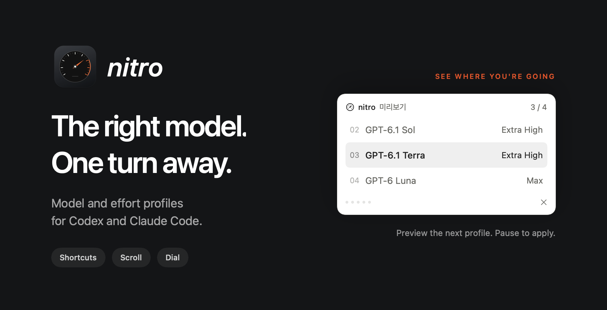
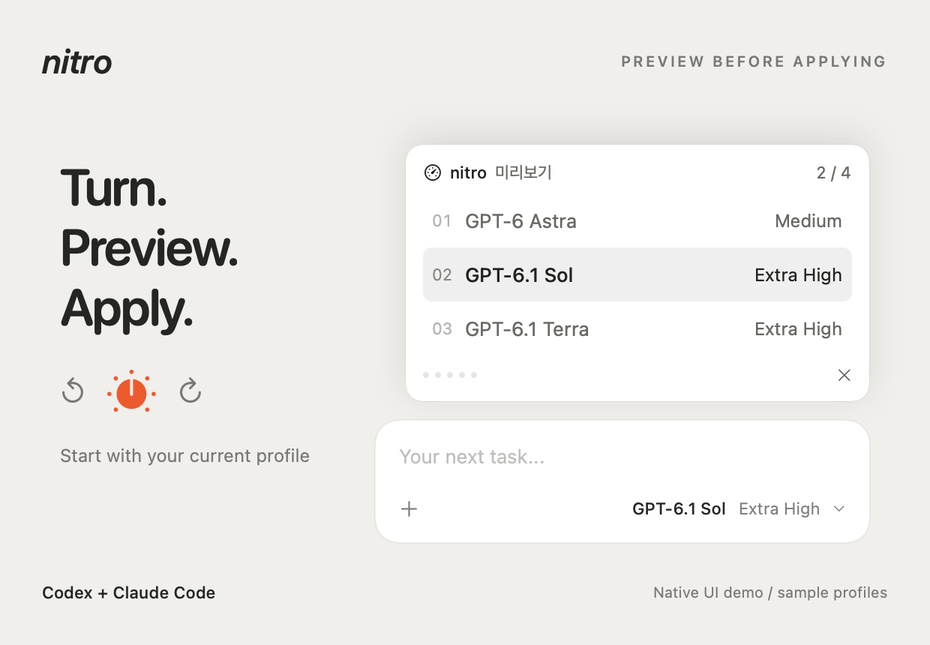

# Nitro

[English](README.md) / [한국어](README.ko.md) / [简体中文](README.zh-CN.md) / [日本語](README.ja.md) / [Español](README.es.md)

**원하는 모델과 에포트, 단축키 한 번으로.**

Nitro는 Codex와 Claude 데스크톱의 Code 탭에서 모델과 추론 에포트를 바꾸는 macOS 메뉴바 앱입니다. 단축키로 프로필을 바로 적용하거나, 이전과 다음으로 이동하거나, 키보드 다이얼을 돌려 고를 수 있습니다.

[Mac용 다운로드](https://github.com/jadhvank/nitro-releases/releases/latest) | [업데이트 내역](https://github.com/jadhvank/nitro-releases/releases) | [문제 제보](https://github.com/jadhvank/nitro-releases/issues)

Apple Silicon Mac, macOS 13 이상.

## 바꾸기 전에, 어디로 갈지 확인하세요

다이얼을 돌리며 후보를 살펴보고, 원하는 모델과 에포트에서 멈추세요. 잠깐 기다리면 마지막으로 고른 프로필을 한 번만 적용합니다.

미리보기는 현재 프로필에서 시작해 다음 후보로 움직입니다. 선택할 후보는 가운데에, 앞뒤 프로필은 위아래에 보입니다. 더 작게 보고 싶다면 미니 패널로 바꾸세요. 미리보기 없이 바로 적용할 수도 있습니다.

*Nitro의 실제 미리보기 UI와 예시 프로필로 만든 데모입니다. 아래 입력창은 설명용입니다. 사용 가능한 모델은 계정과 클라이언트 버전에 따라 다릅니다.*

## 원하는 방식으로 전환

| 조작 | 동작 |
| --- | --- |
| 프로필 단축키 | 저장한 모델과 에포트를 바로 적용합니다. 원하는 키 조합을 직접 입력해 지정합니다. |
| 이전과 다음 | 내 프로필이나 Codex 기본 Power 목록을 순서대로 이동합니다. 미리보고 적용하거나 즉시 적용할 수 있습니다. |
| 마우스 휠 또는 볼륨 다이얼 | 같은 목록을 앞뒤로 이동합니다. 볼륨 다이얼은 지원 앱에 포커스가 있을 때만 모델 이동으로 동작합니다. |

두 앱을 함께 쓰면 포커스된 지원 앱에 맞춰 동작합니다. 하나만 쓰면 다른 앱에서도 일반 단축키로 지정한 앱을 활성화할 수 있습니다. 볼륨 입력은 다른 앱에서 항상 원래대로 동작합니다.

## 다이얼의 볼륨 기능은 그대로

Nitro에서 볼륨키 옵션을 켜세요. VIA 설정은 `KC_VOLD`, `KC_VOLU`, `KC_MUTE` 그대로 두면 됩니다.

- Codex나 Claude의 Code 탭에서는 돌려서 프로필을 이동합니다.
- 다른 앱에서는 원래대로 볼륨을 조절합니다.
- 누르면 원래대로 음소거합니다.

지원 앱에 포커스가 있으면 일반 볼륨 키에도 같은 동작이 적용됩니다. 마우스 휠은 별도 옵션입니다.

## 시작하기

1. 최신 릴리스에서 `Nitro-<버전>.zip`을 받아 압축을 풀고, `Nitro.app`을 응용 프로그램 폴더로 옮깁니다.
2. Nitro를 실행하고 **시스템 설정 → 개인정보 보호 및 보안 → 손쉬운 사용**에서 허용합니다.
3. Nitro 메뉴바 아이콘에서 설정을 열고 Codex, Claude Code, 둘 다 중 선택합니다.
4. 모델 피커가 보이는 채팅을 연 뒤 해당 클라이언트 설정에서 연결을 확인하고 모델 목록을 불러옵니다.
5. 프로필과 단축키를 지정합니다. Codex 기본 Power로 이동하려면 전체 Power 목록을 먼저 불러옵니다.

기본은 앞뒤 프로필을 미리 보여주고 1.2초 동안 입력이 없으면 적용하는 방식입니다. 표시 모양, 대기 시간, 즉시 적용 여부를 바꿀 수 있습니다. 설정의 동작 체험에서는 실제 채팅을 바꾸지 않고 시험할 수 있습니다.

현재 앱 UI는 한국어입니다. 지원 대상은 Codex 데스크톱과 Claude 데스크톱의 Code 탭이며, 브라우저 채팅과 터미널 세션은 포함하지 않습니다.

macOS에서 다운로드한 앱 열기

앱은 Developer ID로 서명되어 있습니다. 현재 릴리스는 Apple 공증을 받지 않아 실행 확인이 표시될 수 있습니다. 실행을 시도한 뒤 다운로드를 신뢰한다면 **시스템 설정 → 개인정보 보호 및 보안 → 확인 없이 열기**를 사용하세요. macOS 보안 기능 전체를 끌 필요는 없습니다.

## 업데이트와 권한

메뉴바의 업데이트 버튼이나 설정의 업데이트 항목에서 새 버전을 확인합니다. Sparkle이 다운로드와 재실행을 처리합니다. 업데이트 파일과 피드는 서명되어 있으며, 업데이트에 GitHub 계정은 필요하지 않습니다.

Nitro는 macOS 손쉬운 사용 API로 각 앱의 기존 모델 피커를 조작합니다. API 키나 로컬 서버 설정은 필요하지 않습니다. 프로필과 진단 로그는 Mac에 저장하며, 대화 내용과 일반 타이핑은 로그에 기록하지 않습니다. 클라이언트 UI가 바뀌면 호환성에 영향을 줄 수 있습니다.

## 이 저장소에 대해

Nitro 다운로드, 문서, 문제 제보를 위한 공개 저장소입니다. 앱 소스는 별도의 비공개 저장소에서 관리합니다. GitHub가 제공하는 **Source code** ZIP과 tarball은 앱 설치 파일이 아닙니다.

SwiftUI와 AppKit으로 만들었습니다. 업데이트에 사용하는 [Sparkle](https://sparkle-project.org/)의 MIT 라이선스는 앱에 포함되어 있습니다. Nitro는 OpenAI 및 Anthropic과 제휴하지 않은 독립 프로젝트입니다.

[개발자 jadhvank](https://github.com/jadhvank)
