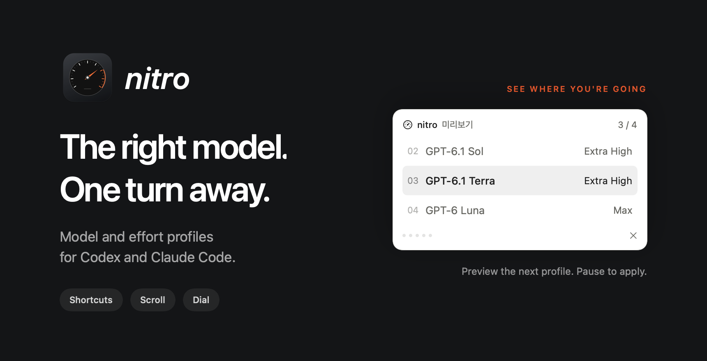
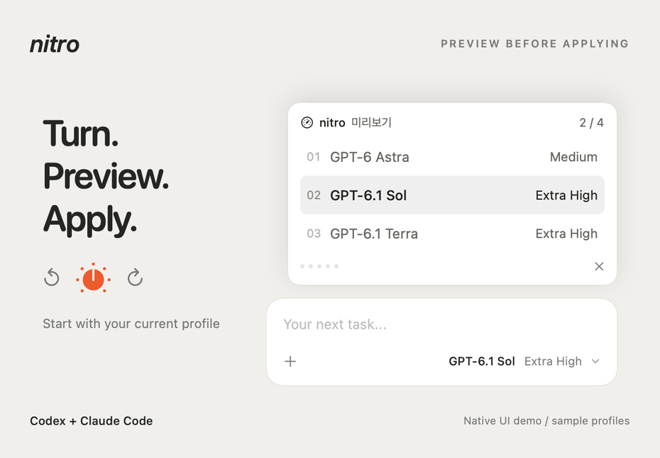

# Nitro

[English](README.md) / [한국어](README.ko.md) / [简体中文](README.zh-CN.md) / [日本語](README.ja.md) / [Español](README.es.md)

**Your model and effort, one shortcut away.**

Nitro is a native macOS menu bar app for switching model and reasoning effort profiles in Codex and the Code tab of Claude Desktop.  
Pick a profile with a shortcut, step through your list, or turn your keyboard dial.

[Download for Mac](https://github.com/jadhvank/nitro-releases/releases/latest) | [Release notes](https://github.com/jadhvank/nitro-releases/releases) | [Report an issue](https://github.com/jadhvank/nitro-releases/issues)

Apple silicon.  
macOS 13 or later.

## See the next profile before you switch

Keep turning to browse.  
Stop when the model and effort look right.  
Nitro waits for a short pause, then applies your choice once.

The preview starts at your current profile and slides toward the next one. Your destination stays in the center, with its neighbors above and below.

Prefer less on screen?  
Choose the mini panel, or switch immediately without a preview.

*Demo built with Nitro's native preview UI and sample profiles.  
The surrounding composer is illustrative.  
Available models depend on your account and client version.*

## Three ways to switch

| Control | What it does |
| --- | --- |
| Profile shortcut | Apply a saved model and effort directly. Record your own key combination. |
| Previous and next | Browse your profiles, or Codex's built-in Power presets. Preview before applying, or switch immediately. |
| Mouse wheel or volume dial | Move through the same list. A volume dial works as model control only while a supported app is focused. |

Use both clients? Nitro follows the supported app in focus.  
Use just one? Regular shortcuts can bring that app forward even when you're elsewhere.  
Volume controls always keep their normal behavior in other apps.

## Keep your dial's volume controls

Enable the volume-key option in Nitro.  
Leave your VIA mappings as `KC_VOLD`, `KC_VOLU` and `KC_MUTE`.

- In Codex or Claude's Code tab, turn to move between profiles.
- In other apps, turn to adjust volume as usual.
- Press to mute as usual.

This also affects ordinary volume keys while a supported app is focused.  
Mouse-wheel control is a separate option.

## Get started

1. Download `Nitro-<version>.zip` from the latest release.  
   Unzip it and move `Nitro.app` to Applications.
2. Open Nitro and allow it in **System Settings → Privacy & Security → Accessibility**.
3. Open settings from Nitro's menu bar icon.  
   Choose Codex, Claude Code, or both.
4. Open a chat with its model picker visible, then check the connection and load the available models in the relevant client settings.
5. Set up your profiles and shortcuts.  
   For Codex Power navigation, load the complete Power list first.

The default navigation mode previews the neighboring profiles and applies after a 1.2-second pause.  
Layout, delay and immediate switching are configurable.  
The settings preview lets you try them without changing a real chat.

**The current app interface is in Korean.** These README translations do not change the app's UI language.  
Nitro supports Codex Desktop and the Code tab in Claude Desktop, not browser chats or terminal sessions.

Opening a download on macOS

The app is Developer ID signed. The current release is not Apple-notarized, so macOS may ask for confirmation.

After attempting to open it, use **System Settings → Privacy & Security → Open Anyway** if offered and you trust the download.  
There is no need to disable Gatekeeper globally.

## Updates and permissions

Use the update action in Nitro's menu bar or the update section in settings.  
Sparkle handles downloads and relaunching.  
Update archives and the feed are signed; downloading updates does not require a GitHub account.

Nitro uses macOS Accessibility to operate the clients' existing model pickers. No API keys or local server setup are needed.

Profiles and diagnostic logs stay on your Mac.  
Chat content and ordinary typing are not written to those logs.  
Client UI changes can affect compatibility.

## About this repository

This is the public home for Nitro downloads, documentation and issues.  
App source is maintained in a separate private repository.  
GitHub's **Source code** ZIP and tarball are not the app download.

Built with SwiftUI and AppKit.  
Updates use [Sparkle](https://sparkle-project.org/), whose MIT license is included in the app.  
Nitro is an independent project, not affiliated with OpenAI or Anthropic.

[Made by jadhvank](https://github.com/jadhvank)
