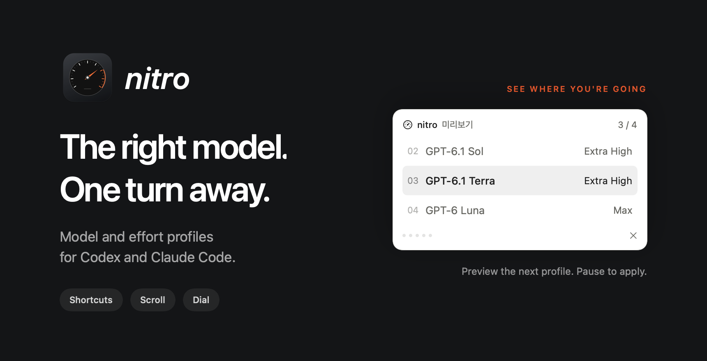
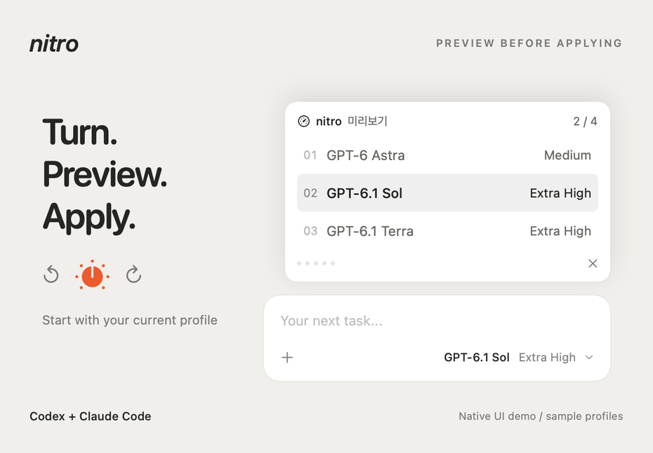

# Nitro

[English](README.md) / [한국어](README.ko.md) / [简体中文](README.zh-CN.md) / [日本語](README.ja.md) / [Español](README.es.md)

**模型和推理强度，一键切换。  
**

Nitro 是一款原生 macOS 菜单栏应用，用于切换 Codex 和 Claude 桌面应用 Code 标签页中的模型与推理强度。  
用快捷键直接应用预设，按顺序切换，或转动键盘旋钮来选择。

[下载 Mac 版](https://github.com/jadhvank/nitro-releases/releases/latest) | [更新记录](https://github.com/jadhvank/nitro-releases/releases) | [反馈问题](https://github.com/jadhvank/nitro-releases/issues)

需要 Apple 芯片 Mac，运行 macOS 13 或更高版本。

## 先看清，再切换

转动旋钮浏览候选项，看到合适的模型和推理强度后停下来。  
Nitro 会稍作等待，再一次性应用最终选择。

预览从当前预设开始，沿切换方向滑向下一项。  
待应用的预设始终位于中间，前后两项显示在上下两侧。  
想减少屏幕占用，可以改用迷你面板，也可以关闭预览，直接切换。

*使用 Nitro 原生预览界面和示例预设制作。  
下方输入框仅作示意。  
可用模型取决于账号和客户端版本。  
*

## 按你的习惯操作

| 操作方式 | 功能 |
| --- | --- |
| 预设快捷键 | 直接应用已保存的模型和推理强度。按下你想用的组合键即可录入。 |
| 上一个和下一个 | 按顺序浏览自定义预设或 Codex 内置 Power 预设。可先预览，也可立即应用。 |
| 鼠标滚轮或音量旋钮 | 在同一列表中前后移动。音量旋钮仅在支持的应用获得焦点时用于切换模型。 |

同时使用两个客户端时，Nitro 跟随当前获得焦点的受支持应用。  
只使用一个客户端时，普通快捷键也能从其他应用切换到指定客户端。  
音量输入在其他应用中始终保持原有功能。

## 保留旋钮的音量功能

在 Nitro 中开启音量键选项。  
VIA 映射保持为 `KC_VOLD`、`KC_VOLU` 和 `KC_MUTE` 即可。

- 在 Codex 或 Claude 的 Code 标签页中，转动旋钮切换预设。
- 在其他应用中，照常调节音量。
- 按下旋钮，照常静音。

受支持应用获得焦点时，普通音量键也会执行相同的切换操作。  
鼠标滚轮控制是独立选项。

## 开始使用

1. 从最新版本页面下载 `Nitro-<版本号>.zip`，解压后将 `Nitro.app` 移到“应用程序”文件夹。
2. 打开 Nitro，在 **系统设置 → 隐私与安全性 → 辅助功能** 中授权。
3. 从 Nitro 菜单栏图标打开设置，选择 Codex、Claude Code 或同时使用两者。
4. 打开能看到模型选择器的对话，在相应客户端的设置中检查连接并加载模型列表。
5. 设置预设和快捷键。  
   使用 Codex Power 导航前，先加载完整的 Power 列表。

默认模式会预览相邻预设，在停止输入 1.2 秒后应用。  
你可以调整布局、等待时间，或改为立即应用。  
设置中的交互演示不会更改真实对话的模型。

**当前应用界面为韩语。  
** README 翻译不会改变应用的界面语言。  
支持范围是 Codex 桌面应用和 Claude 桌面应用的 Code 标签页，不包括浏览器对话或终端会话。

在 macOS 上打开下载的应用

应用已使用 Developer ID 签名，但当前版本尚未经过 Apple 公证，macOS 可能要求确认。  
尝试打开后，如果你信任下载来源，可在 **系统设置 → 隐私与安全性** 中选择“仍要打开”。  
无需全局关闭 Gatekeeper。

## 更新和权限

通过 Nitro 菜单栏中的更新操作或设置中的更新选项检查新版本。  
Sparkle 负责下载和重新启动。  
更新文件和更新源均已签名，下载更新不需要 GitHub 账号。

Nitro 通过 macOS 辅助功能操作客户端已有的模型选择器，无需 API 密钥或本地服务器。  
预设和诊断日志保存在你的 Mac 上，日志不记录对话内容或普通键盘输入。  
客户端界面变化可能影响兼容性。

## 关于此仓库

此公开仓库提供 Nitro 下载、文档和问题反馈。  
应用源码由另一个私有仓库管理。  
GitHub 自动生成的 **Source code** ZIP 和 tarball 不是应用安装包。

使用 SwiftUI 和 AppKit 构建。  
更新组件 [Sparkle](https://sparkle-project.org/) 的 MIT 许可证随应用附带。  
Nitro 是独立项目，与 OpenAI 或 Anthropic 无隶属或合作关系。

[开发者 jadhvank](https://github.com/jadhvank)
